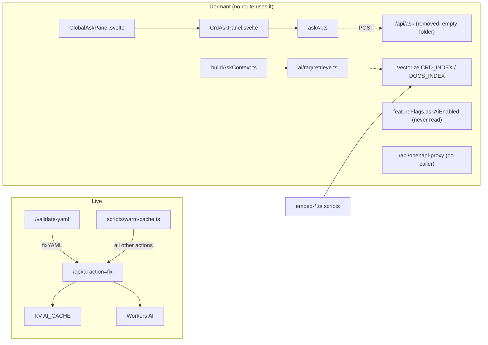

# Code health & analysis

Internal review of the EDA Resource Browser codebase (2026-10-23). **Repo-only — not published on
the site.** Public documentation lives in `src/lib/docs/pages/` and is served at `/docs`.

Nothing listed here was removed or changed as part of the review.

## Summary

| Area                                                                                                          | Status                                                                            |
| ------------------------------------------------------------------------------------------------------------- | --------------------------------------------------------------------------------- |
| User-facing tools (catalog, search, validate, compare, dependency map, API explorer/compare, release changes) | Healthy, well tested                                                              |
| AI                                                                                                            | Only **AI Fix** is live; a whole Ask-AI + RAG stack is dormant                    |
| Routing                                                                                                       | Several legacy routes are redirect-only but still carry full page components      |
| Build                                                                                                         | `prebuild` is skipped by the Cloudflare build scripts                             |
| Tests                                                                                                         | 811 server tests pass; 3 data-dependent failures; client test project is empty    |
| SEO                                                                                                           | CRD content renders client-side only; titles and descriptions are server-rendered |
| Security                                                                                                      | Headers, input limits, proxy allowlist in place; dependency audits clean          |

## Live vs dormant code

### Findings

1. **Ask-AI stack is dead code.** `GlobalAskPanel.svelte` → `CrdAskPanel.svelte` → `askAI.ts` posts to
   `/api/ask`, which no longer exists (`src/routes/api/ask/` is empty). No route imports either panel.
   `featureFlags.askAiEnabled` is never read.
2. **RAG/Vectorize unused at runtime.** `ai/rag/*`, `buildAskContext.ts`, most of `buildRichContext.ts`,
   `resolveAskTargets`, `classifyQuestionIntent` and `eval/goldenQuestions` are only reached from
   tests and the embed scripts. The `CRD_INDEX` / `DOCS_INDEX` bindings are declared but unused by
   any request.
3. **LLM actions without a UI.** `explain`, `field`, `example`, `compare`, `spec-search` and
   `validate` on `/api/ai` are only called by `warm-cache.ts` (or nothing). They are reachable
   publicly and can spend AI quota.
4. **`/api/openapi-proxy` has no caller** in the app. It is hardened (origin allowlist, no
   redirects, size limit) but is still a public relay to the configured EDA API.
5. **Redirect routes with dead bodies.** `/[name]/[version]/+page.svelte`, `/spec-search-auto/+page.svelte`
   (~1,200 lines) and the `/api-browser` pages never render: their loads always redirect.
6. **Empty route folders**: `src/routes/{robots.txt,sitemap.xml,sitemaps/pages.xml,sitemaps/crds.xml,api/ask,configlet-builder}`.
7. **`/sitemap` page links to redirect URLs** (`/<crd>/<version>`) and still lists `/spec-search-auto`.
8. **`_routes.json` excludes `/releases/*`**, but no `static/releases/` folder exists.

## Build and deploy pitfalls

9. **`prebuild` only runs with `npm run build`.** The Cloudflare scripts call `vite build` directly, so
   generated files must be regenerated and committed separately. Easy to deploy a stale sitemap or
   release notes.
10. **README was inaccurate** about `prebuild` always running and referenced a missing "Vectorize RAG"
    section (fixed alongside the docs).
11. **Two lockfiles** (`package-lock.json`, `pnpm-lock.yaml`) must be updated together; drift
    changes what Cloudflare Pages installs.
12. **`deploy:cloudflare` and `deploy:cloudflare:phase1` are identical.**

## Testing gaps

13. **Client Vitest project is empty**: no `*.svelte.test.ts` files, and its setup file
    `vitest-setup-client.ts` doesn't exist, so the project would fail if a test were added.
14. **3 failing server tests depend on data** that changed or was never committed
    (`formatDependencyMap`, `auditCorpus`, `computeUnifiedGraphLayout`: missing
    `static/openapi/26.4.3/.../flowsampling.json`, hard-coded CRD counts).
15. **E2E coverage is thin**: home page, OpenAPI catalog, release-notes deprecation, docs.
16. **14 pre-existing `svelte-check` errors** in validation, OpenAPI and release-notes modules.

## SEO

17. CRD details are rendered in the browser after hydration. Titles, descriptions and canonicals
    are server-rendered (since 2026-10-23), but the schema text itself isn't in the initial HTML.
    Server-rendering a short summary per CRD (kind, group, versions, top-level fields) would help
    indexing.
18. CRD pages live at query URLs (`/?release&crd&version`). Clean path URLs would be friendlier,
    but the current `/<crd>/<version>` paths 307-redirect to the query form, so they can't be the
    canonical today.

## Recommendations (by priority)

| #   | Action                                                                                                | Effort | Benefit                             |
| --- | ----------------------------------------------------------------------------------------------------- | ------ | ----------------------------------- |
| 1   | Run generators in `build:cloudflare` (or a `predeploy`) so deploys can't ship stale data              | S      | Correctness                         |
| 2   | Add a Cloudflare rate-limit rule on `/api/ai`; consider allowing only `fix` from the public endpoint  | S      | Cost control                        |
| 3   | Remove or quarantine the dormant Ask-AI / RAG stack and the unused proxy, or wire them into a feature | M      | Less attack surface and maintenance |
| 4   | Delete dead page bodies under redirect routes and the empty route folders                             | S      | Clarity                             |
| 5   | Fix or update the 3 data-dependent tests; add `vitest-setup-client.ts` or drop the client project     | S      | Green CI                            |
| 6   | Point `/sitemap` at canonical query URLs and drop `/spec-search-auto`                                 | S      | SEO consistency                     |
| 7   | Server-render a CRD summary in the catalog page                                                       | M      | Indexing                            |
| 8   | Clear the 14 `svelte-check` errors                                                                    | M      | Type safety                         |
| 9   | Add CI (GitHub Actions) running `check`, server tests and audits                                      | S      | Regressions caught early            |
