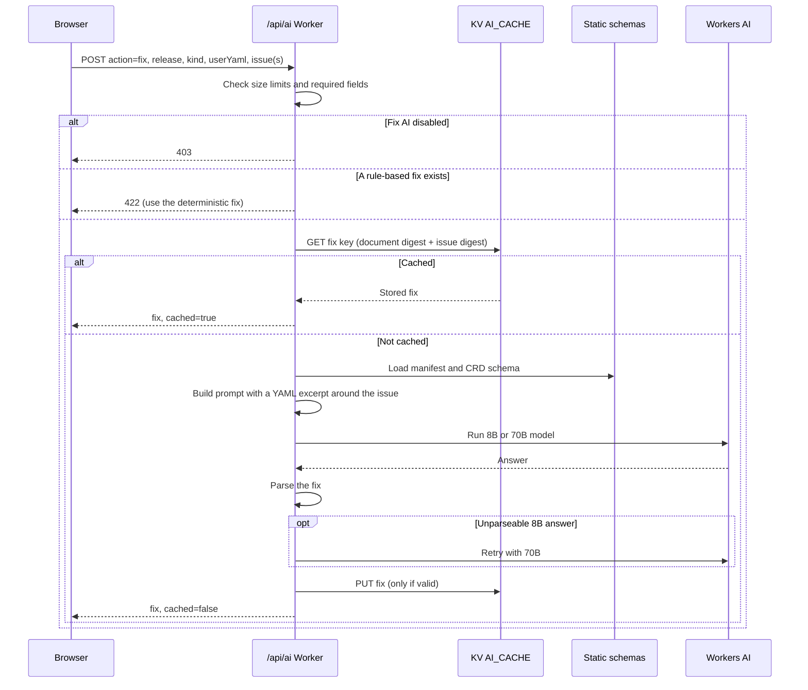

The site uses **Cloudflare Workers AI** for one user-facing feature: **AI Fix** in
[Validate YAML](validate-yaml.md). The same endpoint, `POST /api/ai`, also exposes other actions
that are used by the cache-warming script.

> [!NOTE]
> Only the `fix` action is called from the UI today. The other actions are kept for cache warming
> and future features.

## Actions

| Action           | LLM? | Returns                                                              |
| ---------------- | ---- | -------------------------------------------------------------------- |
| `fix`            | Yes  | Corrected YAML for one issue, several issues, or a syntax error      |
| `explain`        | Yes  | Plain-language explanation of a CRD (falls back to a schema summary) |
| `field`          | Yes  | Explanation of one field (falls back to schema facts)                |
| `example`        | Yes  | Example manifests; one is picked per response                        |
| `compare`        | Yes  | What changed for a CRD between two releases                          |
| `spec-search`    | Yes  | Answer to a free-text question about a CRD                           |
| `validate`       | Yes  | Review of a manifest (never cached)                                  |
| `schema-summary` | No   | Deterministic summary of the schema                                  |
| `relationships`  | No   | Deterministic list of related CRDs                                   |
| `dependency-map` | No   | Release-wide dependency summary from `dependency-graph.json`         |
| `full-context`   | No   | Summary + relationships + any cached explain/example, joined         |

All LLM calls use `temperature = 0` and a fixed seed, so the same input gives the same answer
and can be cached.

## Models

| Model                                      | Used for                                                                                                      |
| ------------------------------------------ | ------------------------------------------------------------------------------------------------------------- |
| `@cf/meta/llama-3.1-8b-instruct-fast`      | Default for all actions and simple fixes                                                                      |
| `@cf/meta/llama-3.3-70b-instruct-fp8-fast` | Batched fixes, relocations, migrations, deeply nested fields — and a retry when the 8B answer can't be parsed |

Timeouts are 90 s (120 s for fixes).

## A fix request, step by step



## Request limits

| Limit        | Value                        |
| ------------ | ---------------------------- |
| Request body | 1 MB                         |
| `userYaml`   | 512 KiB (same as the editor) |
| `field`      | 1,024 characters             |
| `issues`     | 100 per request              |

## Cache keys

Answers are stored in KV without expiry. Keys are versioned (`v2`) so a format change can't
return stale shapes:

```text
ai:v2:{release}:{kind}:{group}:{apiVersion}:{field}:{compareRelease}:{action}
ai:v2:fix:{release}:{kind}:{group}:{fieldPath}:{issueKind}:{docDigest}:{messageDigest}
ai:v2:fix-migration:{release}:{kind}:{group}:{docDigest}:{issueIdsDigest}
```

Missing parts are written as `none`; release-wide entries use the kind `__release__`.

## Failures and fallbacks


Fallback answers are marked `llmFallback: true` with a reason, so the UI can say the answer is
basic.

## Feature flags

| Variable                | Effect                                                    |
| ----------------------- | --------------------------------------------------------- |
| `PUBLIC_FIX_AI_ENABLED` | `false` disables AI Fix (UI and endpoint). On by default. |
| `PUBLIC_ASK_AI_ENABLED` | Reserved for an Ask-AI panel; currently unused.           |

The **lean** deploy (`npm run deploy:cloudflare:lean`) turns both off and deploys without any
AI, KV or Vectorize bindings.

## Warming the cache

`scripts/warm-cache.ts` calls `/api/ai` for every CRD of a release so the deterministic answers
(and optionally `explain` / `example`) are already in KV:

```bash
npm run warm:cache -- --release 26.8.2
WARM_ACTIONS=explain,example npm run warm:cache:llm -- --release 26.8.2
```

It checks that `dependency-graph.json` is reachable first, then warms `dependency-map` once and
`schema-summary`, `relationships` and `full-context` per CRD. Concurrency, pauses, retries and
timeouts are set with `CONCURRENCY`, `SLEEP_MS`, `WARM_RETRIES` and `FETCH_TIMEOUT_MS`.
`GET /api/cache-status?release=…&kind=…` shows what is cached for one CRD.
