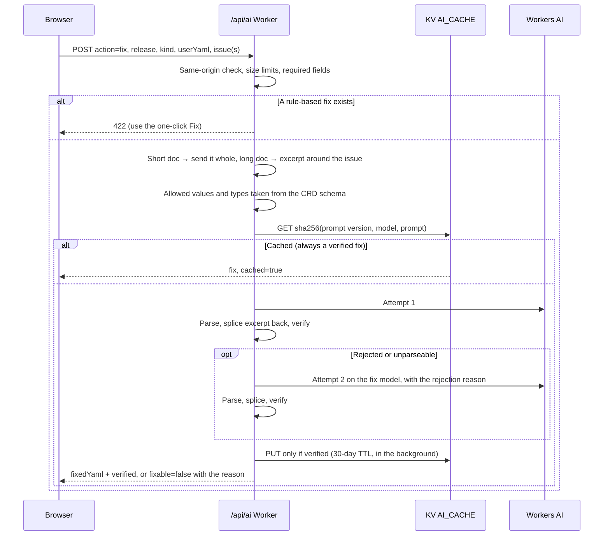
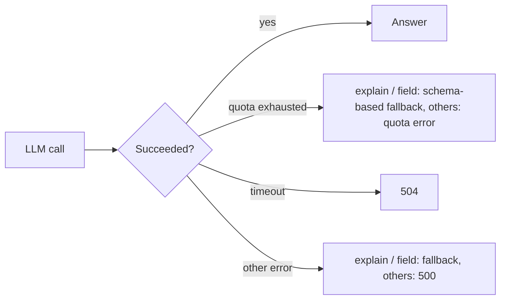

The site uses **Cloudflare Workers AI** in [Validate YAML](validate-yaml.md): **AI Fix** and the
**More detail (AI)** field explanation. Both go through `POST /api/ai`.

## Actions

| Action                                            | LLM? | Used by               | Returns                                                                                           |
| ------------------------------------------------- | ---- | --------------------- | ------------------------------------------------------------------------------------------------- |
| `fix`                                             | Yes  | AI Fix                | Corrected YAML for one issue, several issues, or a syntax error — **verified**                    |
| `field`                                           | Yes  | Explain → More detail | Plain-language explanation of one field (falls back to schema facts)                              |
| `explain`                                         | Yes  | cache warming         | Explanation of a CRD (falls back to a schema summary)                                             |
| `example`                                         | Yes  | cache warming         | Example manifests; one is picked per response                                                     |
| `spec-search`                                     | Yes  | —                     | Answer to a free-text question about a CRD                                                        |
| `schema-summary`, `relationships`, `full-context` | No   | cache warming         | Deterministic text built from the schema                                                          |
| `dependency-map`                                  | No   | cache warming         | Release-wide dependency summary                                                                   |
| `validate`, `compare`                             | —    | —                     | **Disabled (404)**: they duplicated the browser validator and the diff engine and only cost quota |

All LLM calls use `temperature = 0` and a fixed seed, so the same input gives the same answer
and can be cached.

## Models

| Tier        | Default model                              | Override           |
| ----------- | ------------------------------------------ | ------------------ |
| Default     | `@cf/meta/llama-3.1-8b-instruct-fast`      | `AI_MODEL_DEFAULT` |
| Fix / retry | `@cf/meta/llama-3.3-70b-instruct-fp8-fast` | `AI_MODEL_FIX`     |

Simple fixes start on the default model; batched, relocation, migration and deeply nested fixes start
on the fix model. Output token limits are sized from the document the model must return (about
1.3× its tokens, at most 4,096). Timeouts are 90 s (120 s for fixes).

## A fix request, step by step



### Long documents

Documents up to **200 lines** are sent whole and the model returns the whole document. Longer ones
are cut to the lines around the issue; the model returns **only those lines**, and the server
splices them back by line range. The model never has to reproduce text it didn't see.

### Verification

Before a fix is returned or cached, the server checks it:

1. it parses as a single YAML object;
2. the minimal-edit guard passes — `kind` and `apiVersion` unchanged, no unrelated keys added, a
   bounded number of changed lines (the same guard the browser uses);
3. the reported issue is resolved — enum value now allowed, type matches the schema, required field
   present, unknown field removed. YAML syntax fixes only need to parse.

Ajv can't run in Workers (it compiles validators with `new Function`), so the server checks the
issue directly against the schema; the browser then re-runs full validation on the result.

## Request limits

| Limit        | Value                                                                              |
| ------------ | ---------------------------------------------------------------------------------- |
| Request body | 1 MB                                                                               |
| `userYaml`   | 512 KiB (same as the editor)                                                       |
| `field`      | 1,024 characters                                                                   |
| `issues`     | 100 per request                                                                    |
| Origin       | Same-origin browser requests only (scripts without an `Origin` header are allowed) |

## Cache keys

```text
ai:v3:fix:{release}:{sha256(promptVersion, model, system prompt, user prompt)}   (30-day TTL)
ai:v2:{release}:{kind}:{group}:{apiVersion}:{field}:{compareRelease}:{action}     (other actions)
```

Fix keys hash everything that shaped the answer. Hints sent by the browser are part of the prompt,
so a crafted request can only populate its own key — never the entry other users read — and only
verified fixes are written. Bumping `FIX_PROMPT_VERSION` retires all cached fixes.

## Failures and fallbacks



The browser cancels requests when you press **Cancel** or close the AI panel, and gives up after
130 s.

## Observability

Every AI call writes one JSON log line (`{"evt":"ai", …}`) with the action, release, kind, cache
hit, whether the fix was verified, attempts, model, excerpt or full mode, the reject reason and the
latency. Read them in **Workers & Pages → your project → Logs** to track the fix success rate.

## Measuring fix quality

`src/lib/ai/eval/fixCases.ts` holds 20 real cases (enum, type, required, unknown field, syntax, and a
long document) built on the 26.8.2 schemas, each with an independent check. Run them against any
deployment:

```bash
npm run eval:fix -- --base-url https://<preview>.eda-resource-browser.pages.dev
```

The report lists pass/fail per case, latency, cache hits and retries. Use it before changing a
model or a prompt.

## Feature flags

| Variable                | Effect                                                         |
| ----------------------- | -------------------------------------------------------------- |
| `PUBLIC_FIX_AI_ENABLED` | `false` disables AI features (UI and endpoint). On by default. |
| `PUBLIC_ASK_AI_ENABLED` | Reserved for an Ask-AI panel; currently unused.                |

The **lean** deploy (`npm run deploy:cloudflare:lean`) turns both off and deploys without any
AI, KV or Vectorize bindings.

## Warming the cache

`scripts/warm-cache.ts` calls `/api/ai` for every CRD of a release so the deterministic answers
(and optionally `explain` / `example`) are already in KV:

```bash
npm run warm:cache -- --release 26.8.2
WARM_ACTIONS=explain,example npm run warm:cache:llm -- --release 26.8.2
```

`GET /api/cache-status?release=…&kind=…` shows what is cached for one CRD.
