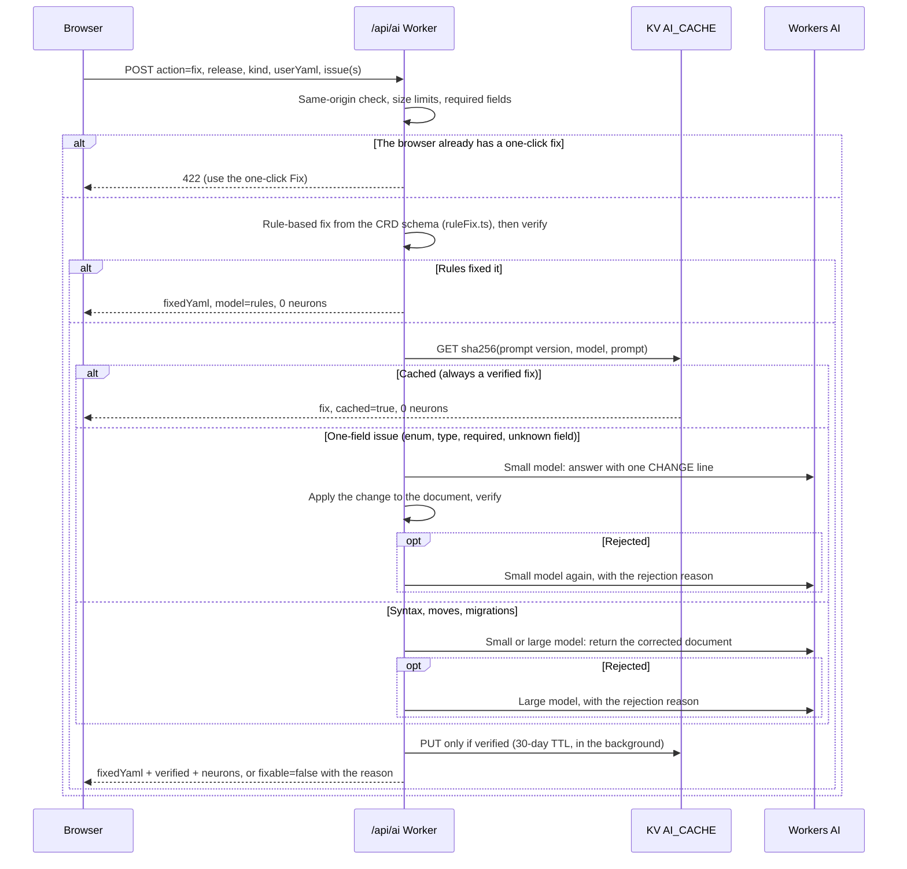
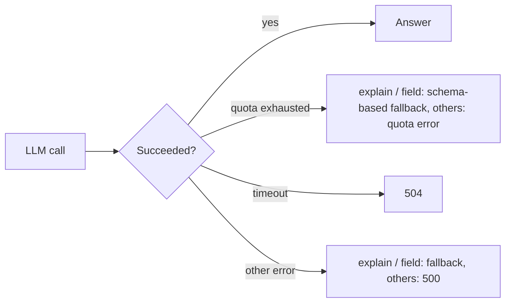

The site uses **Cloudflare Workers AI** in [Validate YAML](validate-yaml.md): **AI Fix** and the
**More detail (AI)** field explanation. Both go through `POST /api/ai`.

## Actions

| Action                                            | LLM? | Used by               | Returns                                                                                           |
| ------------------------------------------------- | ---- | --------------------- | ------------------------------------------------------------------------------------------------- |
| `fix`                                             | Yes  | AI Fix                | Corrected YAML for one issue, several issues, or a syntax error — **verified**                    |
| `field`                                           | Yes  | Explain → More detail | Plain-language explanation of one field (falls back to schema facts)                              |
| `explain`                                         | Yes  | cache warming         | Explanation of a CRD (falls back to a schema summary)                                             |
| `example`                                         | Yes  | cache warming         | Example manifests; one is picked per response                                                     |
| `spec-search`                                     | Yes  | —                     | Answer to a free-text question about a CRD                                                        |
| `schema-summary`, `relationships`, `full-context` | No   | cache warming         | Deterministic text built from the schema                                                          |
| `dependency-map`                                  | No   | cache warming         | Release-wide dependency summary                                                                   |
| `validate`, `compare`                             | —    | —                     | **Disabled (404)**: they duplicated the browser validator and the diff engine and only cost quota |

All LLM calls use `temperature = 0` and a fixed seed, so the same input gives the same answer
and can be cached.

## Models

| Tier        | Default model                              | Override           |
| ----------- | ------------------------------------------ | ------------------ |
| Default     | `@cf/meta/llama-3.1-8b-instruct-fast`      | `AI_MODEL_DEFAULT` |
| Fix / retry | `@cf/meta/llama-3.3-70b-instruct-fp8-fast` | `AI_MODEL_FIX`     |

Simple fixes start on the default model; batched, relocation, migration and deeply nested fixes start
on the fix model. Output token limits are sized from the document the model must return (about
1.3× its tokens, at most 4,096). Timeouts are 90 s (120 s for fixes).

Model trials on the 61-case eval (October 2026): `@cf/qwen/qwen2.5-coder-32b-instruct` as the fix
model scored the same as the 70B default, and `@cf/meta/llama-4-scout-17b-16e-instruct` for both
tiers scored one case lower at about twice the latency, so the defaults stay.

## AI Gateway

Set `AI_GATEWAY_ID` (a gateway in the same Cloudflare account) to send every Workers AI call through
[AI Gateway](https://developers.cloudflare.com/ai-gateway/) for request logs, token and cost
analytics, and optional rate limits. The gateway's own cache is skipped (`skipCache`): only fixes
that pass verification are cached, in KV. Without the variable the app calls Workers AI directly.

## A fix request, step by step

Cheapest first: rules, then the cache, then the small model, and the large model only for
whole-document fixes.



### Rules before AI

`src/lib/ai/ruleFix.ts` fixes what the schema decides, with no model call:

| Issue         | Rule                                                                                            |
| ------------- | ----------------------------------------------------------------------------------------------- |
| Enum          | The one allowed value that matches by case or spelling (`SRL` → `srl`, `Global` → `GlobalPool`) |
| Type          | Quoted numbers and booleans (`"9000"` → `9000`, `"yes"` → `true`, `AS65000` → `65000`)          |
| Unknown field | Remove it with its block                                                                        |
| Misspelled    | Rename to the field the validator names                                                         |
| Required      | Add it when the schema gives a default or a single allowed value                                |

Edits are line-based (`yamlLineEdit.ts`), so comments and formatting stay as written, and each
result goes through the same verification as AI answers. On the 61 eval cases, rules fix 45,
including the two YAML syntax errors (a missing colon, a misaligned line). Rule fixes keep working
when the Workers AI daily allocation is used up.

### One-line answers

For enum, type, required and unknown-field issues the model doesn't echo the document: it answers
`CHANGE: SET spec.links.0.speed = 25G` (or `DELETE <path>`), and the server applies it
(`fixPatch.ts`). Output tokens cost about 8 times as much as input tokens, so this is most of the
saving on the calls that still need a model. These fixes retry on the same small model; the 70B
model (about 13 times the cost per call) is kept for syntax errors, moves and migrations.

### Neurons

Measured on the same 61-case run (October 2026), with Cloudflare's own counts:

| Version                               | Model calls | 70B calls | Neurons              | Passed                      |
| ------------------------------------- | ----------- | --------- | -------------------- | --------------------------- |
| Before (whole-document answers)       | 69          | 23        | ~2,258               | 54/61                       |
| Rules + one-line answers              | 24          | 2         | ~184                 | 54/61                       |
| Plus syntax rules and the fixes above | about 16    | 0         | under 100 (estimate) | 56/61 with no AI quota left |

The free Workers AI allocation is 10,000 neurons a day.

Each fix response and log line carries `neurons`: an estimate from the token counts Workers AI
reports and Cloudflare's per-model prices (`estimateNeurons` in `runWorkersAI.ts`). Rules and cache
hits are 0.

### Long documents

Documents up to **200 lines** are sent whole and the model returns the whole document. Longer ones
are cut to the lines around the issue; the model returns **only those lines**, and the server
splices them back by line range. The model never has to reproduce text it didn't see.

### Verification

Before a fix is returned or cached, the server checks it:

1. it parses as a single YAML object;
2. the minimal-edit guard passes — `kind` and `apiVersion` unchanged, no unrelated keys added, a
   bounded number of changed lines (the same guard the browser uses);
3. the reported issue is resolved — enum value now allowed, type matches the schema, required field
   present, unknown field removed. YAML syntax fixes only need to parse.

Ajv can't run in Workers (it compiles validators with `new Function`), so the server checks the
issue directly against the schema; the browser then re-runs full validation on the result.

## Request limits

| Limit        | Value                                                                              |
| ------------ | ---------------------------------------------------------------------------------- |
| Request body | 1 MB                                                                               |
| `userYaml`   | 512 KiB (same as the editor)                                                       |
| `field`      | 1,024 characters                                                                   |
| `issues`     | 100 per request                                                                    |
| Origin       | Same-origin browser requests only (scripts without an `Origin` header are allowed) |

## Cache keys

```text
ai:v3:fix:{release}:{sha256(promptVersion, model, system prompt, user prompt)}   (30-day TTL)
ai:v2:{release}:{kind}:{group}:{apiVersion}:{field}:{compareRelease}:{action}     (other actions)
```

Fix keys hash everything that shaped the answer. Hints sent by the browser are part of the prompt,
so a crafted request can only populate its own key — never the entry other users read — and only
verified fixes are written. Bumping `FIX_PROMPT_VERSION` retires all cached fixes.

## Failures and fallbacks



The browser cancels requests when you press **Cancel** or close the AI panel, and gives up after
130 s.

## Observability

Every AI call writes one JSON log line (`{"evt":"ai", …}`) with the action, release, kind, cache
hit, whether the fix was verified, attempts, model (`rules` when no model was called), one-line or
document mode, tokens in and out, estimated neurons, the reject reason and the latency. Read them in **Workers & Pages → your project → Logs** to track the fix success rate.

## Measuring fix quality

`src/lib/ai/eval/` holds 61 cases, each with an independent check of the returned document:

- 20 hand-written ones (enum, type, required, unknown field, syntax, and a long document sent as an
  excerpt);
- 41 made by breaking the curated docs.eda.dev examples (`fixCasesCurated.ts`): Fabric, BGP peers
  and groups, default routers, routing policy, services, topology, and multi-issue documents where
  only the reported issue may change.

The eval runs on the **latest release** in `src/lib/releases.yaml` (or `--release`). It asks the
validator which issue each case triggers in that release, so messages and allowed values follow
each release without edits; a case that is no longer invalid is skipped.

```bash
npm run eval:fix -- --base-url https://<preview>.eda-resource-browser.pages.dev --min-pass 0.85
```

The report lists pass/fail per case, latency, rules / cache / attempts, and neurons, with totals.

### Every new release, automatically

When a release is added (a push to `main` that changes `src/lib/releases.yaml` or
`openapi-releases.yaml`):

1. **CI** validates the curated Insert examples and the eval cases against the new latest release,
   so a schema change that breaks them fails the build.
2. **New release check** (`.github/workflows/new-release.yml`) waits until the release's data is
   live on the site, then runs the eval on it and fails below an 80% pass rate. The job summary
   shows the neurons it used.

**Actions → AI Fix eval → Run workflow** runs it by hand against production or a preview, for any
release.

## Feature flags

| Variable                | Effect                                                         |
| ----------------------- | -------------------------------------------------------------- |
| `PUBLIC_FIX_AI_ENABLED` | `false` disables AI features (UI and endpoint). On by default. |

The **lean** deploy (`npm run deploy:cloudflare:lean`) turns it off and deploys without the AI
and KV bindings.

## Warming the cache

`scripts/warm-cache.ts` calls `/api/ai` for every CRD of a release so the deterministic answers
(and optionally `explain` / `example`) are already in KV:

```bash
npm run warm:cache -- --release 26.8.2
WARM_ACTIONS=explain,example npm run warm:cache:llm -- --release 26.8.2
```

`GET /api/cache-status?release=…&kind=…` shows what is cached for one CRD.
