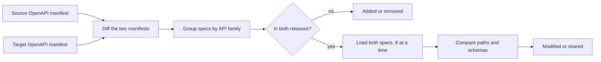

**API Comparison** (`/openapi-comparison`) shows how the EDA REST API changed between a source and
a target release.

## Using it

1. In the compare bar, choose the **source** and **target** releases (`?sr=...&tr=...` in the URL;
   a link with both runs the comparison on load), then press **Compare**.
2. Summary tiles count the APIs added, removed and changed, and the operations and schemas that
   changed inside them.
3. Filter by status or text, swap the direction, and open an API to see its endpoint changes,
   marked `+` added, `−` removed and changed. **Copy share link** copies the comparison's URL.

When two releases have no API changes, the page says so and offers to list the unchanged APIs.

## Statuses

| Status    | Meaning                                                                           |
| --------- | --------------------------------------------------------------------------------- |
| Added     | The API exists only in the target release                                         |
| Removed   | The API exists only in the source release                                         |
| Modified  | Paths or schema content changed                                                   |
| Unchanged | Same content in both (a change of version string alone still counts as unchanged) |

## How it works

