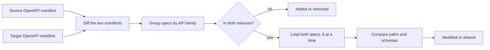

**API Comparison** (`/openapi-comparison`) shows how the EDA REST API changed between a source and
a target release.

## Using it

1. Choose the **source** and **target** releases (`?sr=...&tr=...` in the URL).
2. Run the comparison (button or <kbd>Enter</kbd>). Progress is shown per API family.
3. Filter by status, swap the direction, and open an entry to see path and schema differences.

## Statuses

| Status   | Meaning                                                                |
| -------- | ---------------------------------------------------------------------- |
| Added    | The API exists only in the target release                              |
| Removed  | The API exists only in the source release                              |
| Modified | Paths or schema content changed                                        |
| Shared   | Same content (a change of version string alone still counts as shared) |

## How it works

