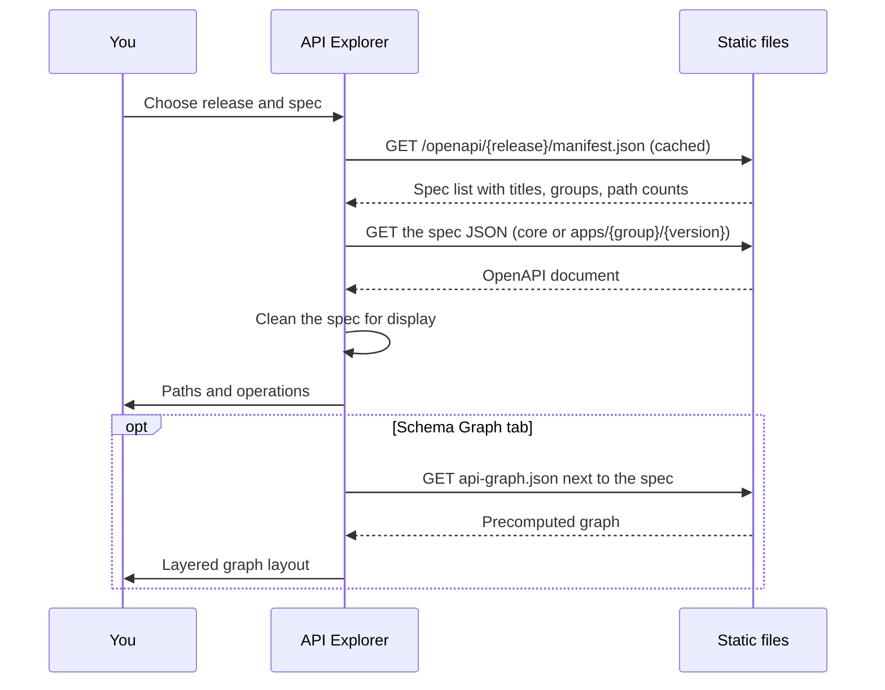

The **API Explorer** (`/openapi`) shows the OpenAPI specifications published by EDA: the core API
and one spec per application API group and version.

## Using it

The page has three parts:

- **Sidebar**: the API picker (core first, then the application APIs), a filter, method toggles
  (GET, POST, PUT, PATCH, DELETE, each with its count) and the tag list. Clicking a tag scrolls to
  it; the tag you're reading is highlighted. On phones the sidebar opens from **Filters and tags**.
- **Endpoints**: every tag is listed open, with the method, the path (path parameters such as
  `{namespace}` highlighted) and the summary. Public endpoints are marked.
- **Endpoint panel**: click an endpoint (or press Enter on it) to open it beside the list, with
  **Copy path**, **Copy curl**, **Show in Schema Graph**, parameters, request and response schemas,
  examples and vendor extensions. On narrower screens it opens over the page; Escape closes it and
  returns to the endpoint.

The release comes from the header's release switcher. **Paths / Schema graph** switches the view:

- _API map_ mode: how paths and schemas connect.
- _Schema dependencies_ mode: which schemas reference which.
- A **fields list check** validates a list of field paths against a schema's leaf fields.

### Keyboard

| Key                       | Action                    |
| ------------------------- | ------------------------- |
| <kbd>/</kbd>              | Focus the endpoint filter |
| <kbd>↑</kbd> <kbd>↓</kbd> | Move between endpoints    |
| <kbd>Enter</kbd>          | Open the endpoint         |
| <kbd>Esc</kbd>            | Close the endpoint panel  |

Links can point to an endpoint (`#operationId`), a tab (`tab=schemaGraph`) or a schema
(`schema=...`).

## How it loads

Specs without any paths are hidden from the list. The graph layout orders each level to reduce
crossing lines.
