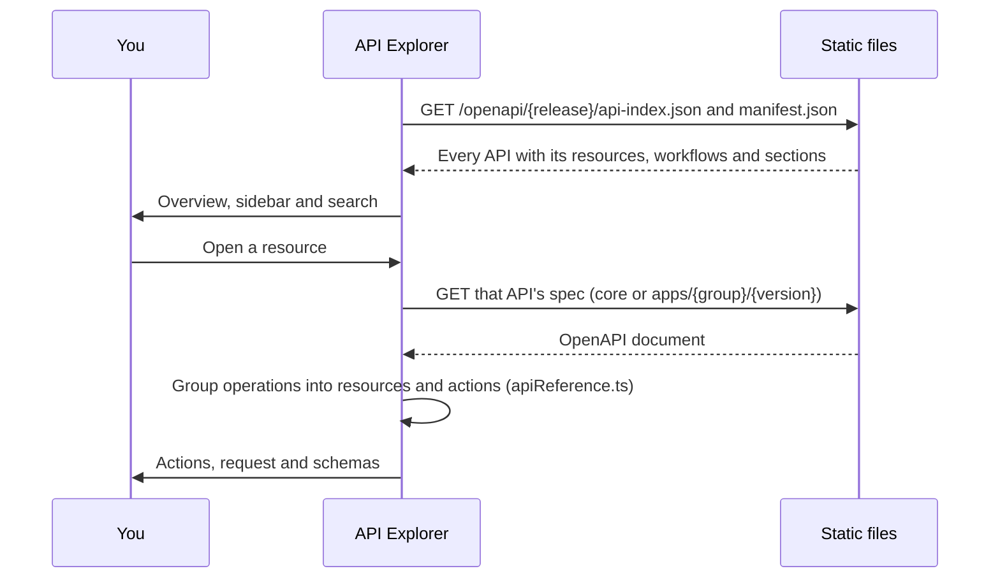

The **API Explorer** (`/openapi`) is the EDA REST API reference for each release, organised the way
you look things up: by resource (BridgeDomain, BGPPeer, Fabric…) and by what you can do with it.

## Using it

1. **Overview** (`/openapi`): how to call the API (paths, bearer token, namespaces), the platform
   API's sections, and every application API with its resources.
2. **Find a resource**: type in the sidebar search (for example `bgp` or `ping`) or open an API in
   the sidebar. <kbd>/</kbd> focuses the search.
3. **Resource page**: the kind, its API group and version, its scope, links to the CRD schema and to
   Validate YAML, and its actions in plain words:

   | Group | Actions                                                                                             |
   | ----- | --------------------------------------------------------------------------------------------------- |
   | Read  | List in namespace, List in all namespaces, Get, Revision history, Intent targets, Deleted instances |
   | Write | Create, Replace, Patch, Delete, Delete all in namespace                                             |
   | Run   | Workflows: Run, Submit input, Terminate (plus Logs and Artifacts under Read)                        |
   | Other | Topology                                                                                            |

4. **Action panel**: a curl to paste (namespace `eda`, an example name, `$TOKEN` and `$EDA_HOST` as
   shell variables, a JSON body file for writes), then the parameters, request body, responses and
   examples from the OpenAPI spec. Arrow keys move between actions.

The release comes from the header's release switcher and is kept when you switch.

Links: `?spec=<api id>&section=<resource plural or platform section>`, and `#operationId` to open an
action. Older links (`?spec=…#operationId`, `tab=schemaGraph`) still open the matching page.

## How it loads

`api-index.json` is built by `npm run build:openapi-index` (part of `generate:all`) with the same
grouping code the page uses, so the overview and the resource pages always agree. Specs without any
paths are left out.
