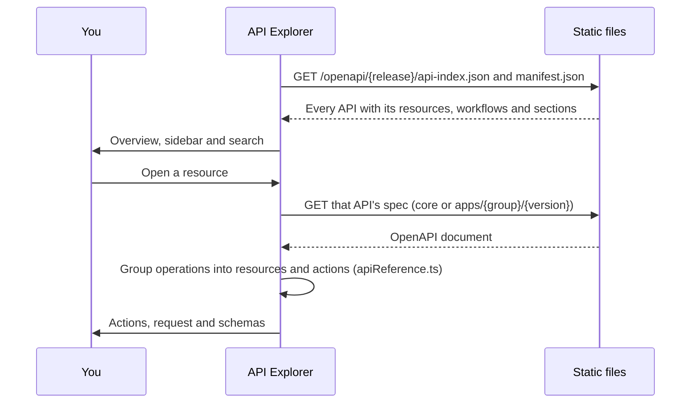

The **API Explorer** (`/openapi`) is the EDA REST API reference for each release, organised the way
you look things up: by resource (BridgeDomain, BGPPeer, Fabric…) and by what you can do with it.

## Using it

1. **Overview** (`/openapi`): a search across every resource and API, the **categories** as tiles,
   popular resources, every API from A to Z (including the **API Server**, `/core`), and how to call
   the API (paths, bearer token, namespaces).
2. **Category** (`?category=routing`): every resource and workflow of the category's APIs in one
   table, with its scope, number of actions and collection path. Filter it, or show only resources or
   only workflows.

   | Category                 | APIs                                                             |
   | ------------------------ | ---------------------------------------------------------------- |
   | Core platform            | API Server (`/core`), Core, Core Extensions                      |
   | Fabric and topology      | Fabrics, Topologies, Interface, Operating System, Components, …  |
   | Routing and protocols    | Protocols, Routing, Routing Policies, MPLS, QoS, OAM, Filters    |
   | Services                 | Services, Micro Segmentation                                     |
   | Telemetry and export     | Kafka, NATS, InfluxDB, OTLP and Prometheus exporters, Logging, … |
   | Alerts and notifications | Notifier, Pager Duty, Discord, ServiceNow                        |
   | Integrations             | Cloud Connect, VMware, Nutanix, NSX, GitHub, GitLab, NetBox, AI  |
   | Access and security      | AAA, Security, Cert Checker, Management                          |
   | System and apps          | Configuration, Store, Bootstrap, Environment, Support            |

   The mapping lives in `src/lib/openapi/apiCategories.ts`; a unit test fails if an API of any
   synced release has no category.

   The sidebar lists the categories; the current one opens to its APIs, and the current API to its
   resources. Its search (<kbd>/</kbd>) finds any resource, for example `bgp` or `ping`.

3. **Resource page**: the kind, its API group and version, its scope, links to the CRD schema and to
   Validate YAML, and its actions in plain words:

   | Group | Actions                                                                                             |
   | ----- | --------------------------------------------------------------------------------------------------- |
   | Read  | List in namespace, List in all namespaces, Get, Revision history, Intent targets, Deleted instances |
   | Write | Create, Replace, Patch, Delete, Delete all in namespace                                             |
   | Run   | Workflows: Run, Submit input, Terminate (plus Logs and Artifacts under Read)                        |
   | Other | Topology                                                                                            |

4. **Action panel**: a curl to paste (namespace `eda`, an example name, `$TOKEN` and `$EDA_HOST` as
   shell variables, a JSON body file for writes), then the parameters, request body, responses and
   examples from the OpenAPI spec. Arrow keys move between actions.

The release comes from the header's release switcher and is kept when you switch.

Links: `?category=<id>`, `?spec=<api id>&section=<resource plural or platform section>`, and `#operationId` to open an
action. Older links (`?spec=…#operationId`, `tab=schemaGraph`) still open the matching page.

## How it loads

`api-index.json` is built by `npm run build:openapi-index` (part of `generate:all`) with the same
grouping code the page uses, so the overview and the resource pages always agree. Specs without any
paths are left out.
