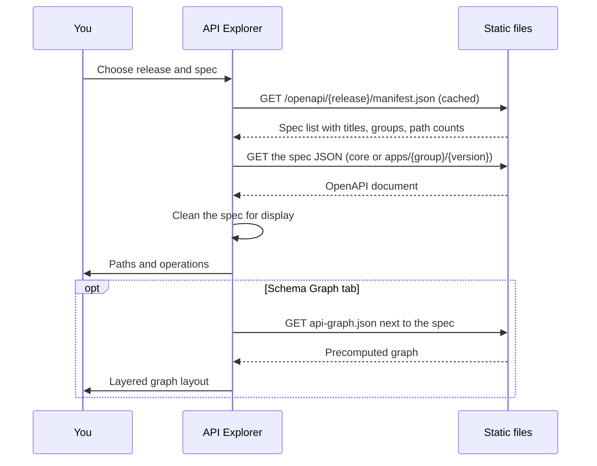

The **API Explorer** (`/openapi`) shows the OpenAPI specifications published by EDA: the core API
and one spec per application API group and version.

## Using it

1. Pick a **release** and a **spec** from the apps menu (for example `core` or an application
   group like `interfaces.eda.nokia.com/v1`).
2. **Paths tab**: browse operations grouped by tag, filter by HTTP method, and open an operation to
   see parameters, request and response schemas, examples and vendor extensions.
3. **Schema Graph tab**: see how schemas relate.
   - _API map_ mode: how paths and schemas connect.
   - _Schema dependencies_ mode: which schemas reference which.
   - A **fields list check** validates a list of field paths against a schema's leaf fields.

Links can point to an operation (`#operationId`), a tab (`tab=schemaGraph`) or a schema
(`schema=...`).

## How it loads

Specs without any paths are hidden from the list. The graph layout orders each level to reduce
crossing lines.
