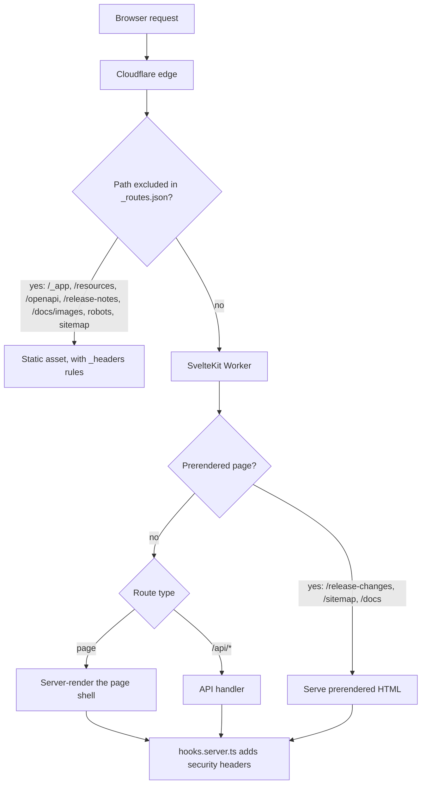
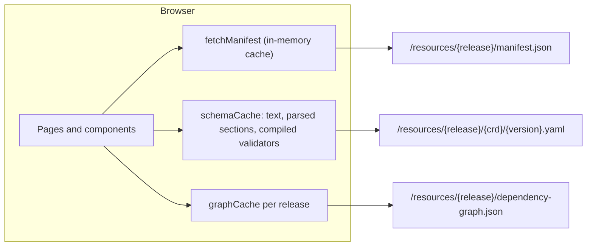

The EDA Resource Browser is a **SvelteKit 2 / Svelte 5** application deployed on **Cloudflare
Pages**. It is designed so that almost everything is a static file, and the browser does the heavy
lifting.

## Building blocks

| Layer      | Technology                | Role                                |
| ---------- | ------------------------- | ----------------------------------- |
| UI         | Svelte 5, Tailwind CSS 4  | Pages and components                |
| Framework  | SvelteKit 2, Vite 7       | Routing, SSR, prerendering, build   |
| Editor     | Monaco                    | YAML editing in Validate YAML       |
| Graphs     | @xyflow/svelte, d3        | Dependency map                      |
| Validation | Ajv, js-yaml              | JSON Schema validation of manifests |
| Docs       | marked, Mermaid           | This documentation                  |
| Hosting    | Cloudflare Pages + Worker | Static assets and server routes     |
| AI         | Cloudflare Workers AI, KV | AI Fix and its cache                |

## Request routing

`@sveltejs/adapter-cloudflare` produces a Worker plus a `_routes.json` file that tells Cloudflare
which paths skip the Worker and go straight to static assets.



- **Static data** (`/resources/*`, `/openapi/*`, `/release-notes/*`) never touches the Worker, so it
  is fast and free to serve.
- **Prerendered pages** are generated as HTML at build time.
- **Client-only pages**: `/validate-yaml` and `/dependency-map` set `ssr = false` because Monaco and
  the graph library need the browser.
- **Other pages** are server-rendered once and then hydrated; after that, navigation happens in
  the browser.

## Server routes

| Route                   | Purpose                                                                         |
| ----------------------- | ------------------------------------------------------------------------------- |
| `POST /api/ai`          | AI actions, mainly the YAML fix (see [AI & caching](ai.md))                     |
| `GET /api/cache-status` | Reports whether AI answers are cached for a CRD; the full summary needs a token |
| `/google…html`          | Search Console verification                                                     |
| `/index.xml`            | Redirect to `/sitemap.xml`                                                      |

## Cloudflare bindings

Declared in `wrangler.toml`:

| Binding    | Type         | Used for                             |
| ---------- | ------------ | ------------------------------------ |
| `AI`       | Workers AI   | LLM calls for AI Fix                 |
| `AI_CACHE` | KV namespace | Caching AI and deterministic answers |

The `nodejs_compat` compatibility flag is enabled.

## Client-side data layer



- `src/lib/manifest/fetch.ts` loads and caches release manifests.
- `src/lib/yaml-validation/schemaCache.ts` caches schemas and validators, and checks every path
  segment against `[a-z0-9._-]` before building a URL.
- Release lists come from `src/lib/releases.yaml` (CRDs) and `src/lib/openapi-releases.yaml` (APIs).

## Theming

An inline script in `src/app.html` applies the `dark` class before the first paint (from
`localStorage` or the system preference), so there is no flash of the wrong theme.
`src/lib/theme.ts` holds a store that keeps all theme toggles in sync; styles use Tailwind's
`dark:` variants.

The header and homepage use a small token set in `src/app.css` (`--rb-surface`, `--rb-ink`,
`--rb-signal`, …) with light values on `:root` and dark values on `.dark`, so both themes come from
one definition. The design reference, with before and after screenshots, is in `design/`.

## Navigation

`AppHeader.svelte` is one row on every page:

| Part             | What it does                                                                                                                   |
| ---------------- | ------------------------------------------------------------------------------------------------------------------------------ |
| **CRDs** menu    | Catalog, Spec Search, Dependency Map, Release Changes, Compare releases                                                        |
| **API** menu     | API Explorer, Compare APIs                                                                                                     |
| **Docs**         | This documentation                                                                                                             |
| Jump to a CRD    | Press `/` anywhere (outside a text field) to search the current release's CRDs and open one                                    |
| Release switcher | On pages that read `?release=` (catalog, Spec Search, Dependency Map, Validate YAML); reloads the page with the chosen release |
| Validate YAML    | Always-visible button                                                                                                          |

Menus open on click or with the Down arrow, arrows move between links, Escape closes. On phones a
menu button opens the same groups as a sheet. The homepage shows the CRD search, a releases panel
with one row per major version (its four newest releases, newest first, each with its CRD changes
from `static/release-notes/index.json`, and a menu with the rest; `src/lib/releaseLines.ts`), and
the tools grouped by task. The API reference groups the application APIs into categories
(`src/lib/openapi/apiCategories.ts`), selectable with `?category=`.

## Project layout

```text
src/
  routes/           pages and server routes (one folder per tool)
  lib/
    components/     shared UI (header, CRD window, tree, release select)
    comparison/     CRD diff engine and UI
    spec-search/    field search engine
    validate-bundle/, yaml-validation/   validation and fix pipeline
    dependency-map/ graph building and layout
    openapi/, openapi-comparison/, schemaGraph/   API explorer and diff
    release-notes/  release notes generation and presentation
    ai/             /api/ai prompts, models, cache
    docs/           this documentation (markdown pages, renderer)
static/
  resources/{release}/   CRD YAML, manifest.json, dependency-graph.json
  openapi/{release}/     OpenAPI specs, manifest.json, graphs
  release-notes/         generated release notes
scripts/            build-time generators and maintenance tools
```
