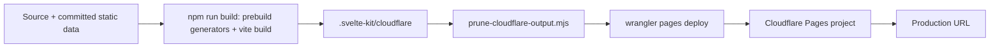
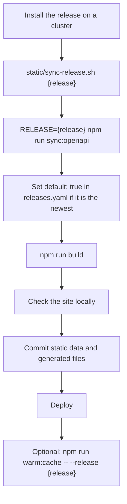

## Requirements

- **Node.js 24.22.1** or newer (pinned in `.node-version`, enforced by `engines` with
  `engine-strict=true`). Cloudflare Pages reads `.node-version` for its builds.
- npm or pnpm. Both lockfiles are kept in sync: `package-lock.json` for npm, `pnpm-lock.yaml` for
  Cloudflare Pages builds.

```bash
nvm install 24.22.1
npm install
npm run dev
```

The dev server listens on all interfaces. For AI features locally, use `npm run dev:ai`, which
builds for Cloudflare and runs `wrangler pages dev` with the AI binding (needs Cloudflare
credentials).

## Build commands

| Command                    | What it does                                                                                         |
| -------------------------- | ---------------------------------------------------------------------------------------------------- |
| `npm run build`            | Runs `prebuild` generators, then `vite build`                                                        |
| `npm run build:cloudflare` | Cleans dev artifacts, runs the generators, `vite build` with the Cloudflare adapter, then prunes |
| `npm run build:vercel`     | Same app with the Vercel adapter                                                                     |
| `npm run check`            | `svelte-check` type checking                                                                         |
| `npm run lint`             | Prettier + ESLint                                                                                    |

> [!NOTE]
> `npm run build` and `npm run build:cloudflare` (used by every `deploy:cloudflare*` script that
> builds) both run `npm run generate:all` first: sitemap, release notes, OpenAPI manifests and
> schema graphs. The generated files change on every build (dates); commit them with your change.
> `deploy:cloudflare:only` deploys an existing build without regenerating.

## Deploying



| Script                   | Use                                                                            |
| ------------------------ | ------------------------------------------------------------------------------ |
| `deploy:cloudflare`      | Build for Cloudflare and deploy                                                |
| `deploy:cloudflare:only` | Prune and deploy an existing build                                             |
| `deploy:cloudflare:lean` | Deploy without AI, KV or Vectorize (swaps in `wrangler.lean.toml` temporarily) |

Wrangler needs a Cloudflare API token in `CLOUDFLARE_API_TOKEN`. Behind a corporate proxy, set
`HTTPS_PROXY` as well. Never commit tokens: local secrets go in `.dev.vars` (git-ignored); see
`.dev.vars.example`.

## Adding an EDA release



See [Data pipeline](data-pipeline.md) for what each step produces.

## Dependency hygiene

- Run `npm audit` and `pnpm audit` after dependency changes; keep both lockfiles updated
  (`pnpm install --lockfile-only`).
- pnpm enforces a minimum release age for new packages. Pin a version that is at least a day old
  rather than adding an exclusion.
- Follow Node.js security releases and update `.node-version` and `engines` together.
