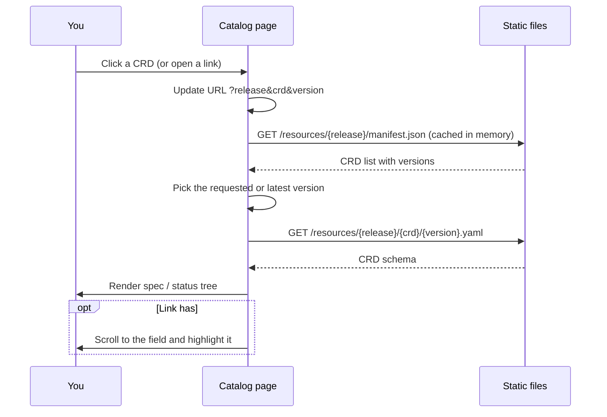

The **Catalog** is the home page (`/`). It lists every CRD in the selected EDA release and opens
each one in a detail window with two tabs: **Schema** and **Compare**.


## Using the catalog

- **Categories and API groups.** The catalog opens on the categories (the same ones as the API
  reference: Core platform, Fabric and topology, Routing and protocols…) as tiles. The sidebar lists
  them with their CRD counts; a category opens to its API groups (`aaa`, `core`, `protocols`…). The
  groups come from the release's CRD manifest, so they follow whatever a release ships; the mapping
  of groups to categories is `src/lib/openapi/apiCategories.ts`, and a unit test fails if a group
  of any release has none. On a phone, categories and groups are a drop-down.
- **Search** (<kbd>/</kbd>) always covers every CRD of the release, by kind, name or group, even
  with a group selected.
- **Filter** between _All_, _Config_ and _State_ CRDs. State CRDs (names containing `states`, such
  as `interfacestates.interfaces.eda.nokia.com`) hold status reported by EDA rather than
  configuration you write.
- **The table** is grouped by API group: kind, scope, versions (the latest first; deprecated ones
  struck through) and full CRD name. Entries the manifest lists without versions, or without a
  group, are still shown (under _other_).
- **Switch releases** with the header's release switcher or from the homepage.

## The CRD window

**Schema tab.** Shows `spec` and `status` from `openAPIV3Schema` as a tree: each field with its
type, whether it's required, enum values, defaults and description. Use the version selector to
switch between API versions of the CRD.

**Compare tab.** Picks another release (or version) and shows the schema differences side by side
for this one CRD.

**Deprecated since.** For a deprecated version, the window shows the first release where it was
marked deprecated. The site works this out by scanning every release's manifest from oldest to
newest.

## Linking to a field

Each field has a `#` button that copies a link like:

```text
/?release=26.8.2&crd=Interface&version=v1#spec.members
```

Opening the link selects the release, opens the CRD at that version, scrolls to the field and
flashes it. Several fields can be highlighted at once: `#spec.a|spec.b`.

## How search ranks results

Every word you type must appear somewhere in the CRD's name, kind or group. Matching CRDs are then
scored per word, and the highest total wins:

| Match                                                       | Points     |
| ----------------------------------------------------------- | ---------- |
| Kind is exactly the word                                    | +1000      |
| Kind starts with the word                                   | +500       |
| Kind contains the word                                      | +100       |
| Short name (first part of the CRD name) is exactly the word | +800       |
| Short name starts with / contains the word                  | +400 / +50 |
| Group is exactly / contains the word                        | +100 / +10 |
| Full name contains the word                                 | +1         |

A small penalty (0.01 per character of the full name) makes shorter, more specific names win ties;
any remaining ties are sorted alphabetically.

## Which version opens by default

When a link doesn't name a version, the catalog opens the **newest non-deprecated** API version.
Versions are ordered by major number first, then stage (GA > beta > alpha), then stage number:
`v2` > `v1` > `v1beta2` > `v1beta1` > `v1alpha1`.

## What happens when you open a CRD



The manifest of a release is loaded during browser idle time when the page opens, so the first
search is instant. Manifests are kept in memory while you use the site.
