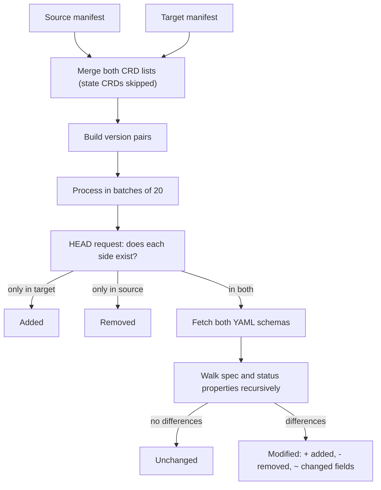

**Comparison** (`/comparison`) compares every CRD between a **source** and a **target** release
(and optionally specific versions), then lists which CRDs were added, removed or modified, and
exactly which fields changed.

## Using it

1. Choose the **source** release and version scope, then the **target**.
2. Click **Compare**. Progress is shown while CRDs are processed.
3. Filter by status (added, removed, modified, unchanged) with the chips, and search the results.
   Turn on **regex** for pattern searches.
4. Click a change line to open a side-by-side view of the field before and after.
5. Use **swap** to reverse the direction, and **export** to download the report as JSON, TXT,
   Markdown or CSV.

The selection is stored in the URL (`?sr=26.4.3&sv=all&tr=26.8.2&tv=all`), and a link with all
four values runs the comparison as soon as it opens.

## Version pairing

| You choose                       | What gets compared                                                      |
| -------------------------------- | ----------------------------------------------------------------------- |
| A specific version on both sides | Exactly that pair                                                       |
| _All_ on both sides              | Each CRD's latest non-deprecated version in the source vs in the target |
| Anything else                    | Every version name found in either release, paired with the same name   |

## How it works

Availability checks and downloaded schemas are cached for the session, so a second comparison of
overlapping releases is much faster.

## Search and regex safety

Searching highlights matches in the results. To keep the page responsive, regex mode falls back
to plain text for patterns longer than 200 characters, scans at most 100,000 characters of a
result and stops after 1,000 matches. An invalid regex is treated as plain text.
