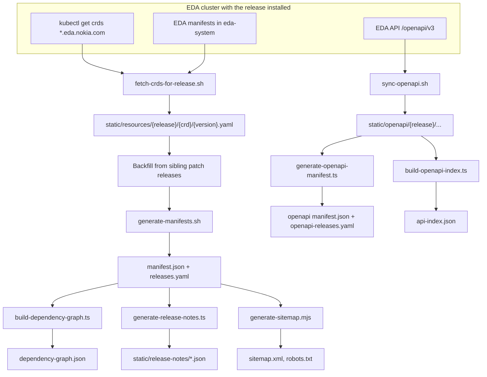

All the data the site shows is produced ahead of time by scripts and committed under `static/`.
Adding an EDA release means running this pipeline against a cluster that has that release
installed.

## End to end



## Steps

| Step               | Command                                        | Output                                                                                       | When                        |
| ------------------ | ---------------------------------------------- | -------------------------------------------------------------------------------------------- | --------------------------- |
| Sync a CRD release | `static/sync-release.sh {release}`             | Runs the next four steps in order                                                            | Manual, per new release     |
| Fetch CRDs         | `static/lib/fetch-crds-for-release.sh`         | One YAML file per CRD version                                                                | Via sync-release            |
| Backfill           | `static/lib/backfill-crds-lib.sh`              | Copies CRDs missing from a patch release from its siblings, with a `.backfilled-from` marker | Via sync-release            |
| Manifests          | `static/generate-manifests.sh`                 | `manifest.json` per release; updates `src/lib/releases.yaml`                                 | Via sync-release or manual  |
| Dependency graph   | `npm run build:dependency-graph`               | `dependency-graph.json` per release                                                          | Via sync-release or manual  |
| Release notes      | `npm run generate:release-notes`               | `static/release-notes/{release}.json`, `index.json`, `bundle.json`                           | `prebuild` and sync-release |
| OpenAPI sync       | `RELEASE={release} npm run sync:openapi`       | Raw discovery plus `core/` and `apps/{group}/{version}/` specs                               | Manual                      |
| OpenAPI manifest   | `npm run generate:openapi-manifest -- --all`   | `static/openapi/{release}/manifest.json`; updates `src/lib/openapi-releases.yaml`            | `prebuild`                  |
| API index          | `npm run build:openapi-index`                  | `static/openapi/{release}/api-index.json`: each API's resources, workflows and sections      | `prebuild`                  |
| Sitemap            | `npm run generate:sitemap`                     | `static/sitemap.xml`, `static/robots.txt`                                                    | `prebuild`                  |
| CRD scope          | `npm run build:crd-scopes`                     | `scope` (Namespaced / Cluster) in each `manifest.json`, from the OpenAPI paths               | `generate:all`              |
| Dependency audit   | `RELEASE={release} npm run audit:dependencies` | `dependency-audit.json` / `.md` report                                                       | Manual                      |

`sync-release.sh` accepts `--dry-run`, `--backfill-only` and `--skip-*` flags to run parts of the
chain.

> [!WARNING]
> `sync:openapi` needs `RELEASE` set. Without it, specs land in `static/openapi/unlabeled/`, which
> the Cloudflare build deletes as a safety measure.

## Data formats

**`manifest.json`** — the index of a release:

```json
[
	{
		"name": "interfaces.interfaces.eda.nokia.com",
		"group": "interfaces.eda.nokia.com",
		"kind": "Interface",
		"versions": [{ "name": "v1" }, { "name": "v1alpha1", "deprecated": true }]
	}
]
```

**CRD YAML** — one file per CRD version, containing that version's entry from `spec.versions[]`,
including `schema.openAPIV3Schema`.

**`releases.yaml`** — ordered release list; one entry has `default: true`:

```yaml
releases:
  - name: '26.8.2'
    label: 'EDA 26.8.2'
    folder: 'resources/26.8.2'
    default: true
```

## Sitemap contents

`generate-sitemap.mjs` writes the tool pages, every CRD of the default release (as
`/?release=…&crd=…&version=…`, matching each page's canonical URL), and every docs page. Kinds
that exist in several API groups use the full CRD name so each URL opens exactly one CRD.
