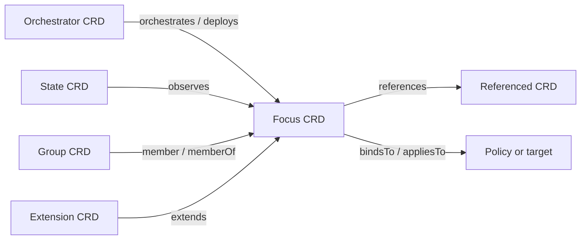
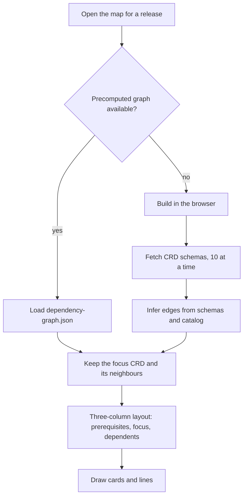

The **Dependency Map** (`/dependency-map`) draws the relationships around one CRD: the resources
it needs (prerequisites) on the left, the CRD itself in the middle, and the resources that use it
(dependents) on the right.

## Using it

1. Pick a release and search for a CRD (same search as the catalog).
2. Toggle **Depends on** and **Required by** to show one or both sides.
3. Filter by resource type, or search inside the graph.
4. Click a card to **drill down**: it becomes the new focus. Breadcrumbs take you back.
5. **View CRD** opens the schema window.

The URL keeps your place: `?release=26.8.2&resource=<crd>`.

## Relationship types

Each line on the map has a relation and a confidence level, depending on how the link was found.

| Evidence                                                      | Example                                         | Confidence |
| ------------------------------------------------------------- | ----------------------------------------------- | ---------- |
| Explicit reference annotations in the schema (`x-references`) | a field declared as a reference to another kind | Highest    |
| Group/version/kind fields                                     | `kind` + `apiVersion` pairs                     | High       |
| Field naming                                                  | fields ending in `Ref`                          | Medium     |
| Selector and orchestration patterns in descriptions           | "selects interfaces with label…"                | Medium     |
| Description text only                                         | a kind name mentioned in prose                  | Low        |
| Catalog pairs                                                 | a config CRD and its matching state CRD         | High       |

Lines are also classed as **hard references** (the field must point at a real resource) or
**intent dependencies** (a looser "works together with" link).

## How the graph is built

Every release ships with a precomputed graph, so the map normally opens without downloading all
schemas. Graphs are cached per release while you use the site.
