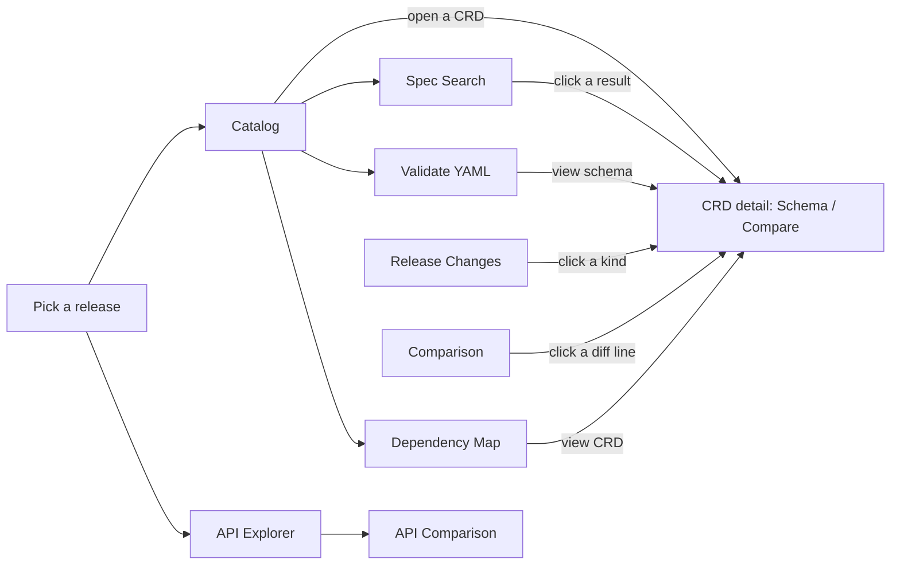
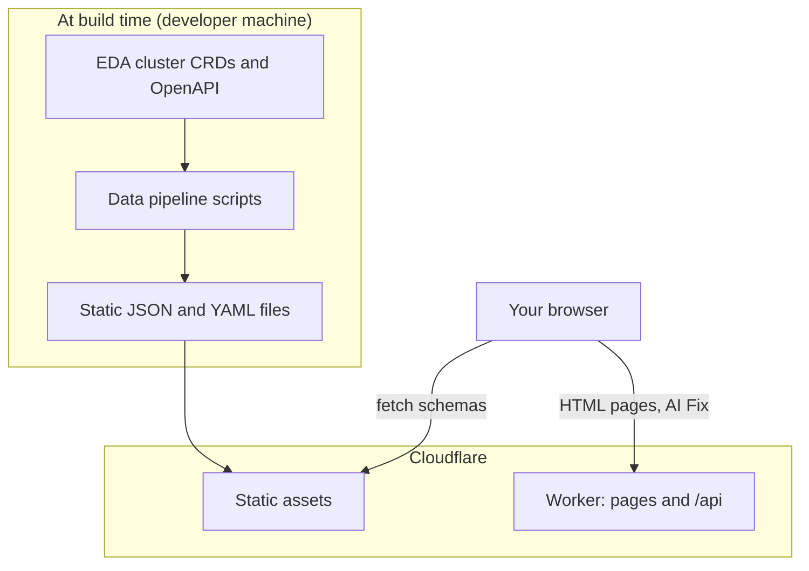

The EDA Resource Browser is a free, community-maintained website for exploring the
**Custom Resource Definitions (CRDs)** and **REST APIs** of Nokia Event-Driven Automation (EDA),
across every published release. Everything runs in your browser from pre-built static data:
you don't need an EDA cluster or an account.

> [!NOTE]
> This site is not affiliated with or endorsed by Nokia. Schemas are extracted from real EDA
> releases, but always confirm critical details against the official EDA documentation.

## The tools at a glance

| Tool                | What you use it for                                                                 | Guide                                 |
| ------------------- | ----------------------------------------------------------------------------------- | ------------------------------------- |
| **Catalog**         | Find a CRD, read its `spec` and `status` schema, compare it with another release    | [Catalog & CRD detail](catalog.md)    |
| **Release Changes** | See what was added, removed, changed or deprecated between two consecutive releases | [Release Changes](release-changes.md) |
| **Spec Search**     | Search for a field name, type or enum value across every CRD at once                | [Spec Search](spec-search.md)         |
| **Validate YAML**   | Paste manifests and check them against the real schemas, then fix errors            | [Validate YAML](validate-yaml.md)     |
| **Comparison**      | Diff all CRD schemas between any two releases and export a report                   | [CRD Comparison](comparison.md)       |
| **Dependency Map**  | See which CRDs a resource depends on and which depend on it                         | [Dependency Map](dependency-map.md)   |
| **API Explorer**    | Browse the EDA OpenAPI specs: paths, operations, schemas and a schema graph         | [API Explorer](api-explorer.md)       |
| **API Comparison**  | Diff the OpenAPI specs of two releases                                              | [API Comparison](api-comparison.md)   |

## Quick start

1. **Choose a release.** The catalog opens on the latest EDA release. The release buttons on
   the home page switch between them, and the choice is kept in the URL (`?release=26.8.2`).
2. **Find a CRD.** Type a kind like `Interface`, a short name like `fabrics`, or a group like
   `routing` in the search box. Press <kbd>Enter</kbd> to open the top match.
3. **Read the schema.** The CRD window shows `spec` and `status` as an expandable tree, with
   types, required fields, enums and defaults.
4. **Share it.** Every view has a URL you can copy. The `#` button next to a field copies a link
   that opens the CRD and highlights that exact field. See [URLs & sharing](urls.md).

## Releases

The site carries one data set per EDA release (currently 25.4.2 to 26.8.2). The newest release is
marked **(latest)** and is the default everywhere. Each tool keeps the release you picked when you
move to another tool through the header or the home page quick actions.

## How it works, in one picture

Almost all work — searching, diffing, validating, graph layout — happens in your browser on
static files. A small Cloudflare Worker renders pages and runs the optional AI Fix. The
[developer guide](architecture.md) explains each part in depth.
