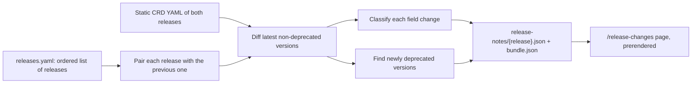

**Release Changes** (`/release-changes`) is a changelog of CRD schemas. For each EDA release it
lists what changed compared to the release just before it.

## What you see

- **A release list** on the side. Pick a release to see its changes since the previous one.
- **Summary cards**: added, removed, modified, deprecated and unchanged CRDs. Click a card to jump
  to that section.
- **Grouping by operational area** — BGP, EVPN, Interfaces, Topology, Policies, Platform and
  Other — so related changes sit together.
- **Per-field changes** for modified CRDs, each with a short plain-English note on its impact.
- **Deprecations**, with the migration path to the replacement version when there is one.
- **A filter box** that highlights matches as you type.
- **Quick links** to open the same release in the catalog, comparison, validation, spec search
  and dependency map.

Click any kind to open its full schema in the CRD window.

## Breaking or not?

Each field change is classified, and some classes count as **breaking** for manifests you
already have:

| Change                        | Breaking?                                 |
| ----------------------------- | ----------------------------------------- |
| New optional field            | No                                        |
| New enum value                | No                                        |
| Default value changed         | No                                        |
| Any change under `status.*`   | No (status is written by EDA, not by you) |
| Field removed                 | **Yes**                                   |
| New required field            | **Yes**                                   |
| Enum value removed or changed | **Yes**                                   |
| Type changed                  | **Yes**                                   |

Changes to schema metadata only (such as `description` or `pattern`) are never counted as breaking.

## How the notes are made

Release notes are generated ahead of time, not in your browser:

Because the page is built from a pre-computed bundle, it opens instantly and works the same for
search engines. The selected release is kept in the URL as `?v=26.8.2`.
