The site is public and has no user accounts, so its security work focuses on safe defaults, limits
on anything that costs money (AI calls, KV reads), and not becoming a relay for attacks.

## Response headers

Set on every response — by `src/hooks.server.ts` for Worker responses and by `_headers` for static
assets (Cloudflare Pages doesn't apply `_headers` to Worker responses):

| Header                                             | Value / purpose                                           |
| -------------------------------------------------- | --------------------------------------------------------- |
| `Strict-Transport-Security`                        | HTTPS only, one year, including subdomains                |
| `X-Content-Type-Options`                           | `nosniff`                                                 |
| `X-Frame-Options` and CSP `frame-ancestors 'self'` | Other sites can't embed the site in a frame               |
| CSP `base-uri 'self'; object-src 'none'`           | Blocks `<base>` hijacking and plugins                     |
| `Referrer-Policy`                                  | `strict-origin-when-cross-origin`                         |
| `Permissions-Policy`                               | Camera, microphone, geolocation, payment and USB disabled |
| `Cross-Origin-Opener-Policy`                       | `same-origin`                                             |

## Protections per endpoint

```mermaid
flowchart TB
  subgraph AI["POST /api/ai"]
    A1["Body at most 1 MB"] --> A2["YAML at most 512 KiB, field at most 1,024 chars, at most 100 issues"]
    A2 --> A3["Action allowlist and required fields"]
    A3 --> A4["Release names resolved from a fixed list; path segments validated"]
  end
  subgraph PX["POST /api/openapi-proxy"]
    P1["Body at most 5 MB"] --> P2["Target origin must be the one configured EDA API"]
    P2 --> P3["Redirects not followed"]
    P3 --> P4["Host, cookie and hop-by-hop headers dropped; generic errors"]
  end
  subgraph CS["GET /api/cache-status"]
    C1["Per-CRD lookups: a few KV reads"] --> C2["Full summary requires a bearer token"]
  end
```

- **AI cost control.** Size limits stop a single request from sending a huge prompt. For extra
  protection, add a Cloudflare rate-limiting rule on `/api/ai`.
- **No server-side request forgery.** The proxy only talks to one configured origin and never
  follows redirects, so it can't be bounced to internal addresses.
- **Cache summary.** `?summary=true` scans every CRD of a release (hundreds of KV reads). It is
  disabled unless the `CACHE_STATUS_TOKEN` secret is set, and then requires
  `Authorization: Bearer …`.

## Rendering untrusted text

- Search highlighting and the markdown renderer for AI text escape HTML before adding their own
  markup.
- That renderer only turns `http(s)` URLs and site-relative paths into links; protocol-relative
  `//host` links are not treated as internal.
- Regex search is bounded (pattern length, scanned text, iterations) to avoid slow patterns.
- Mermaid diagrams in these docs render with `securityLevel: 'strict'`.

## Secrets

- Tokens are passed through environment variables (`CLOUDFLARE_API_TOKEN`) or Cloudflare secrets,
  never committed. `.env*` and `.dev.vars` are git-ignored.
- Rotate any token that was ever pasted into a chat, ticket or log.

## Dependencies and runtime

- Node.js is pinned to a release that includes the latest security fixes (see
  [Build & deploy](build-deploy.md)).
- `npm audit` and `pnpm audit` should report no vulnerabilities before a deploy.
