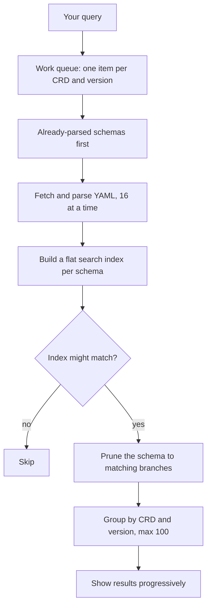

**Spec Search** (`/spec-search`) answers questions like _"which CRDs have a `vlanId` field?"_ or
_"where is the enum value `lacp` used?"_. It searches inside the schemas of every CRD in a release.

## Using it

1. Pick a **release** and, optionally, a **version scope**:
   - _Latest per CRD_ (default): the newest version of each CRD;
   - a specific version name;
   - _all versions_ (`version=*` in the URL).
2. Type a query: a field path (`spec.members`), part of a name (`vlan`), a type (`integer`), an
   enum value or a default.
3. Tick **search descriptions** to also match field descriptions (slower, more results).

Results appear while the search runs, grouped by CRD and version, with the matching fields
listed. Click a result to open the CRD window with those fields highlighted.

> [!TIP]
> You can leave out `spec.` or `status.`: a query for `members` also matches `spec.members`.

## Limits

- At most **100** grouped results are shown. Make the query more specific if you hit the limit.
- State CRDs are skipped, because their fields mirror the config CRDs.
- Typing is debounced by 250 ms, so a search starts when you pause.

## How it works

All of the work happens in your browser:

- **Warm-up.** As soon as you pick a release, schemas start downloading in the background (10 at a
  time), so the first search is faster.
- **Index.** Each schema is turned into one string of tokens: field paths, types, enum values,
  defaults, titles and required/optional markers (plus descriptions if enabled). It matches both
  spaced and compact forms of your query.
- **Pruning.** For a match, only the branches of the schema that contain it are kept, which is
  what you see in the result.
- **Responsiveness.** The search yields to the browser every few batches so the page stays usable.
