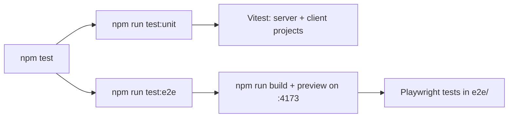

## Test suites

| Suite             | Tool                                      | Location                  | What it covers                                                                                                                                             |
| ----------------- | ----------------------------------------- | ------------------------- | ---------------------------------------------------------------------------------------------------------------------------------------------------------- |
| Server unit tests | Vitest (Node)                             | `src/**/*.test.ts`        | Search ranking, URL state, version picking, schema diff, release notes, validation and fix pipeline, AI prompts and cache keys, graph building, docs pages |
| Component tests   | Vitest browser mode (Playwright Chromium) | `src/**/*.svelte.test.ts` | Svelte components in a real browser                                                                                                                        |
| End-to-end        | Playwright                                | `e2e/*.test.ts`           | The built site served by `vite preview`                                                                                                                    |



## Continuous integration

`.github/workflows/ci.yml` runs on every push to `main` and on pull requests:

| Job                           | Steps                                                                                                                   |
| ----------------------------- | ----------------------------------------------------------------------------------------------------------------------- |
| Type check, unit tests, audit | `npm ci`, `npm run check`, server unit tests, `npm audit --audit-level=high`                                            |
| End-to-end                    | Build, Chromium, Playwright (`e2e/docs.test.ts`, `e2e/validate-yaml.test.ts`); the report is uploaded when a test fails |

Node.js comes from `.node-version`. Workers AI is never called in CI.

## Running tests

```bash
npx vitest --run --project server   # fast unit tests
npm run test:unit                    # watch mode, all projects
npm run test:e2e                     # builds, then runs Playwright
```

Workers AI calls are blocked while tests run (`VITEST` or `CI` set) unless `WORKERS_AI_ALLOW=1`,
so tests never spend AI quota.

## Data-driven tests

Several tests read the real static data under `static/`. When a release is added or regenerated,
tests that assert counts (for example the number of CRDs in a dependency map) may need their
expected values updated.

## Docs tests

`src/lib/docs/registry.test.ts` checks every documentation page: frontmatter, unique slugs, that
internal `/docs/` links point to existing pages, and that no secrets slipped into the text.
`e2e/docs.test.ts` opens each page and checks that Mermaid diagrams render.
