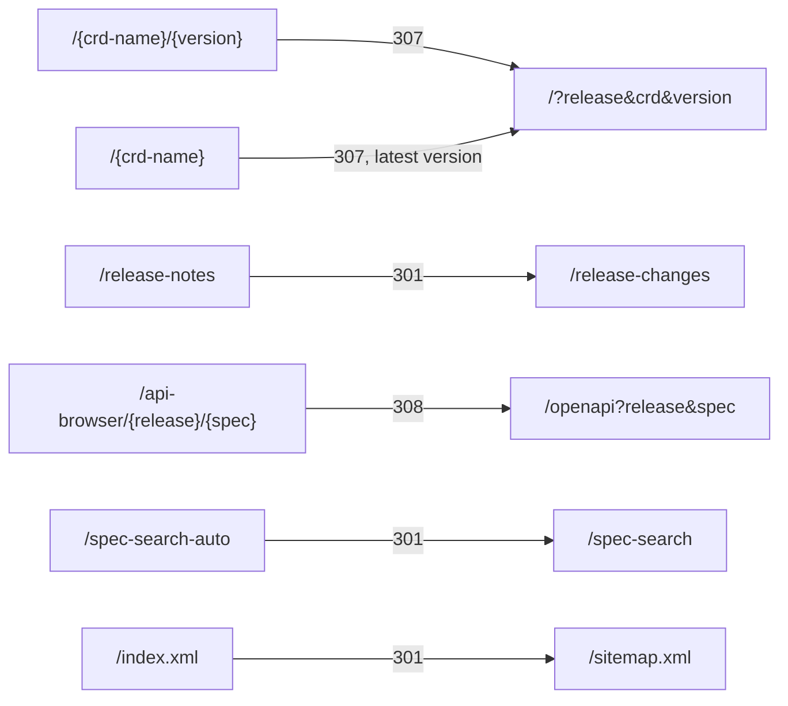

Every tool keeps its state in the URL, so you can bookmark or share exactly what you see.

## Parameters by tool

| Tool            | Path                  | Parameters                                                                         |
| --------------- | --------------------- | ---------------------------------------------------------------------------------- |
| Catalog         | `/`                   | `release`, `crd` (kind or full CRD name), `version`, `#field.path` (several with ` | `)  |
| Release Changes | `/release-changes`    | `v` (release)                                                                      |
| Spec Search     | `/spec-search`        | `release`, `version` (`*` = all versions), `q`                                     |
| Validate YAML   | `/validate-yaml`      | `release`                                                                          |
| Comparison      | `/comparison`         | `sr`, `sv`, `tr`, `tv` (source/target release and version)                         |
| Dependency Map  | `/dependency-map`     | `release`, `resource`, `group`                                                     |
| API Explorer    | `/openapi`            | `release`, `spec`, `tab`, `op`, `schema`, `#operationId`                           |
| API Comparison  | `/openapi-comparison` | `sr`, `tr`                                                                         |
| Docs            | `/docs/<page>`        | `#section`                                                                         |

Examples:

```text
/?release=26.8.2&crd=Interface&version=v1#spec.members
/spec-search?release=26.8.2&q=vlanId
/comparison?sr=26.4.3&sv=all&tr=26.8.2&tv=all
/dependency-map?release=26.8.2&resource=interfaces.interfaces.eda.nokia.com
```

When a CRD kind exists in more than one API group, use the full CRD name in `crd=` so the link
opens the right one.

## Old links keep working

Earlier versions of the site used other URL formats. They redirect to the current ones:



The catalog also accepts `resource=` and `kind=` as aliases of `crd=`, and Release Changes accepts
`release=` as an alias of `v=`.
