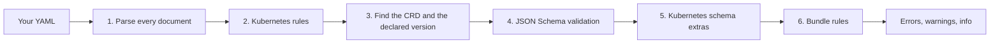
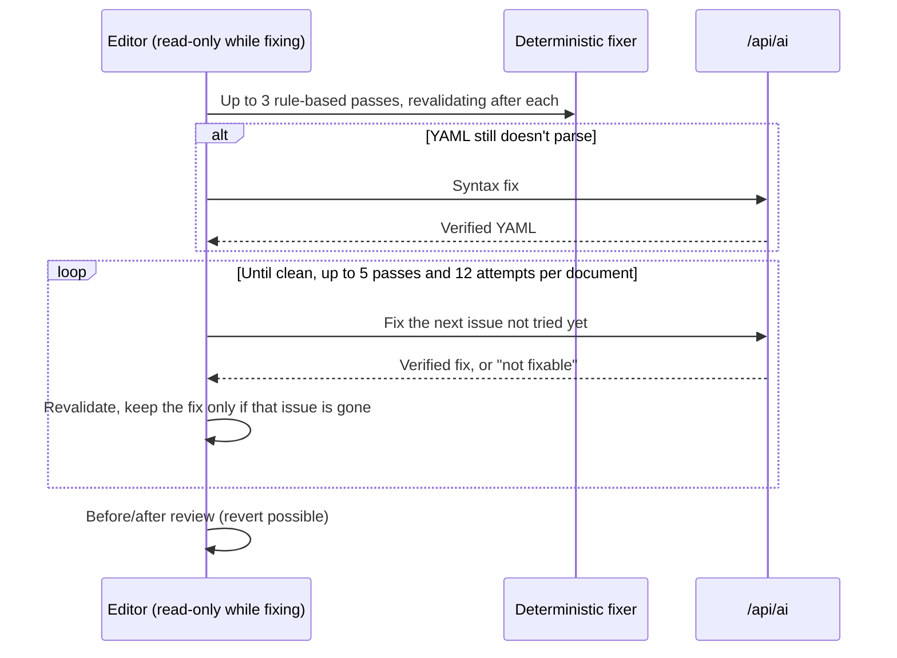

**Validate YAML** (`/validate-yaml`) checks your EDA resource manifests against the CRD schemas of
the release you choose, in an editor with inline errors, completions, hover help and quick fixes.

## Using it

1. Pick the **target release** your manifests are for.
2. Paste or type YAML. Several documents separated by `---` are validated together. Input
   is limited to **512 KiB**.
3. Errors, warnings and hints appear as you type (about half a second after you stop), underlined in
   the editor and listed with filters: **All**, **Errors**, **Warnings**, **Info**.
4. Fix issues one by one, from the editor's lightbulb, or all at once with **AI Fix**.

Your YAML stays **in this page only**: it is not stored in the browser and is gone when you leave
the page. Validation runs in your browser; the document is sent to the server only when you use an
AI feature (AI Fix, AI preview, More detail). Use **Copy**, **Download** or **Copy share link** to
keep it.

### Toolbar

| Button          | What it does                                                                                                                      |
| --------------- | --------------------------------------------------------------------------------------------------------------------------------- |
| Load example    | Replaces the editor with a small valid bundle                                                                                     |
| Copy            | Copies the YAML                                                                                                                   |
| Copy share link | Copies a link that **contains** the YAML (compressed in the URL); opening it loads the same text and release                      |
| Download        | Saves the YAML as `eda-manifests.yaml`                                                                                            |
| Insert example… | Appends a minimal manifest for any kind of the release: required fields only, defaults and placeholders filled in from the schema |

### Keyboard

| Keys                                           | Action                                     |
| ---------------------------------------------- | ------------------------------------------ |
| <kbd>Ctrl</kbd>+<kbd>Enter</kbd>               | Validate now                               |
| <kbd>F8</kbd> / <kbd>Shift</kbd>+<kbd>F8</kbd> | Next / previous issue                      |
| <kbd>Ctrl</kbd>+<kbd>.</kbd>                   | Quick fix for the issue on this line       |
| <kbd>Ctrl</kbd>+<kbd>Z</kbd>                   | Undo — including fixes applied by the tool |

## What gets checked

1. **Parsing**: YAML syntax errors, with line numbers.
2. **Kubernetes rules**: `apiVersion` format, resource names (DNS subdomain and label rules), label
   keys and values.
3. **Schema lookup**: the document's `kind` and API group are matched to a CRD in the selected
   release, and the **version the document declares** is used. A deprecated version is still
   checked against its own schema, with a deprecation warning.
4. **Schema validation**: types, required fields, enums, patterns, ranges, lengths and formats
   (`ipv4`, `date-time`, `uri`, `int32`, and Kubernetes `duration` such as `30s` or `1h30m`).
   Messages name the field, the value found and the rule, for example
   `spec.vlan is 5000; it must be <= 4094`.
5. **Kubernetes schema extras**:
   - unknown fields the schema doesn't define (with rename or relocate suggestions);
   - duplicate items in `set` lists and duplicate keys in `map` lists (`x-kubernetes-list-type`);
   - CEL rules (`x-kubernetes-validations`) are **shown as Info hints** — the cluster enforces them,
     this page doesn't evaluate them;
   - booleans that aren't lowercase (`True`, `FALSE`).
6. **Bundle rules**: the same resource (kind, namespace, name) defined twice, and duplicates that
   use different `apiVersion`s.

`status` is validated only for documents without `spec` (for example exported state). When both are
present, a warning explains that `status` is written by the controller.

Schemas are downloaded once and cached with their compiled validators, so revalidating is fast.

## Understanding an issue

Each issue on a `spec` field has an **Explain** button. It shows, straight from the CRD schema and
at no cost:

- the field's **type** and format, whether it is **required**, **allowed values**, **default**,
  range, length or pattern, and its description;
- for a field that doesn't exist, the **fields allowed at that level**.

**More detail (AI)** asks Workers AI for a plain-language explanation of the field. Answers are
cached, so a second request for the same field is instant.

## Fixing issues

| Option                                | What it does                                                                                            | Uses AI? |
| ------------------------------------- | ------------------------------------------------------------------------------------------------------- | -------- |
| **Fix** on an issue, or the lightbulb | Applies a known correction: rename a misspelled field, move a field, set an allowed value, fix a format | No       |
| **AI preview** on an issue            | Shows an AI fix as a side-by-side diff before you apply it                                              | Yes      |
| **AI Fix** (all issues)               | Deterministic fixes first, AI only for what's left, then a before/after review you can revert           | Partly   |

Every applied fix can be undone with <kbd>Ctrl</kbd>+<kbd>Z</kbd>.

### How AI Fix works

- The server **checks every AI answer before returning it** (see [AI & caching](ai.md)), so you only
  receive fixes that pass validation for the reported issue.
- An issue the AI couldn't fix is **not sent again**; a fix that doesn't remove its issue is rolled
  back.
- The editor is **read-only while fixing**. **Cancel** stops the run and keeps the fixes made so far.

> [!WARNING]
> AI fixes are suggestions. Always review the before/after view, especially values like IP
> addresses, names and references that the AI can't verify against your cluster.
