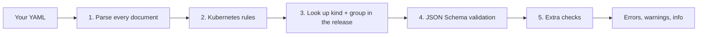
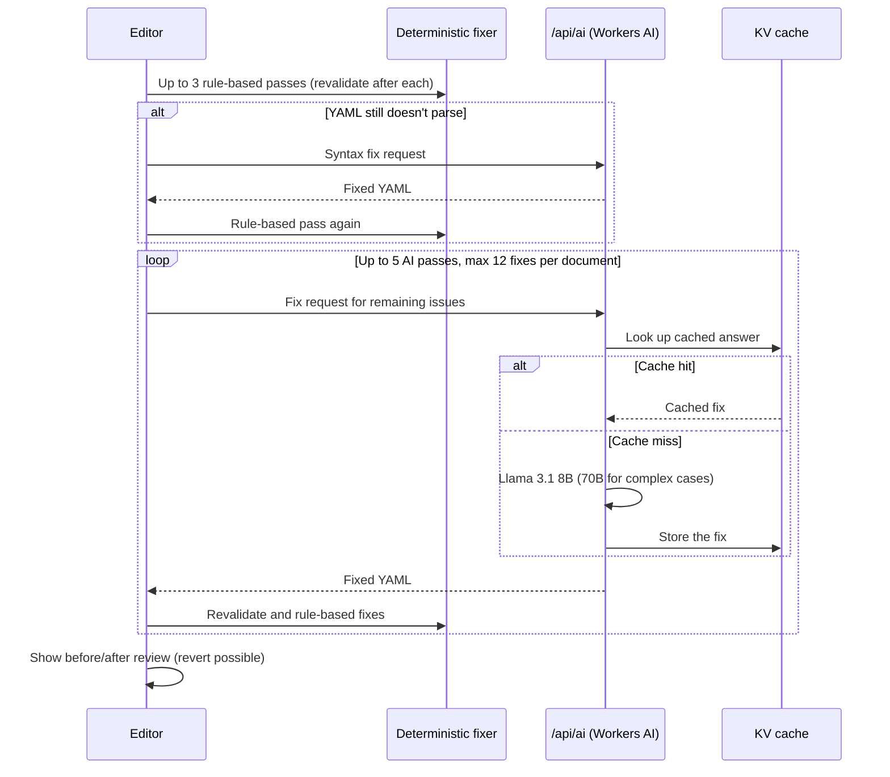

**Validate YAML** (`/validate-yaml`) checks your EDA resource manifests against the CRD schemas of
the release you choose, in an editor with inline errors, completions and hover help.

## Using it

1. Pick the **target release** your manifests are for.
2. Paste or type YAML. Several documents separated by `---` are validated together.
3. Errors and warnings appear as you type (about half a second after you stop), underlined in the
   editor and listed below it.
4. Fix issues one by one with **Fix**, preview an AI suggestion, or run **AI Fix** on everything.
5. Use **view schema** on a resource to open its CRD window.

Input is limited to **512 KiB**.

## What gets checked

1. **Parsing**: YAML syntax errors, with line numbers.
2. **Kubernetes rules**: `apiVersion` format, resource names (DNS subdomain and label rules), label
   keys and values.
3. **Schema lookup**: the document's `kind` and API group are matched to a CRD in the selected
   release. Unknown kinds are reported.
4. **Schema validation**: the document is validated against the CRD's OpenAPI v3 schema (types,
   required fields, enums, patterns, ranges).
5. **Extra checks**: unknown fields that the schema doesn't define, and unquoted booleans that
   aren't lowercase (`True`, `FALSE`): write `true` or `false`.

Schemas are downloaded once and cached, together with their compiled validators, so revalidating
is fast.

## Fixing issues

| Option                     | What it does                                                                                         | Uses AI? |
| -------------------------- | ---------------------------------------------------------------------------------------------------- | -------- |
| **Fix** on an issue        | Applies a known correction: rename a misspelled field, move a field to the right place, fix a format | No       |
| **AI preview** on an issue | Asks the AI for a fix for that issue and shows a side-by-side diff before you apply it               | Yes      |
| **AI Fix** (all issues)    | Runs deterministic fixes first, then AI for what's left, then shows a review you can revert          | Partly   |

AI Fix works in phases, and uses AI only when simple rules can't solve a problem:

> [!WARNING]
> AI fixes are suggestions. Always review the before/after view, especially for values like IP
> addresses, names and references that the AI can't verify.

Identical requests (same document and same issue) are answered from a cache, so repeating a fix is
instant. If the AI can't produce a valid fix, the issue stays listed for you to fix by hand.
